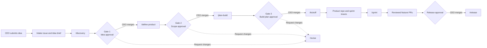
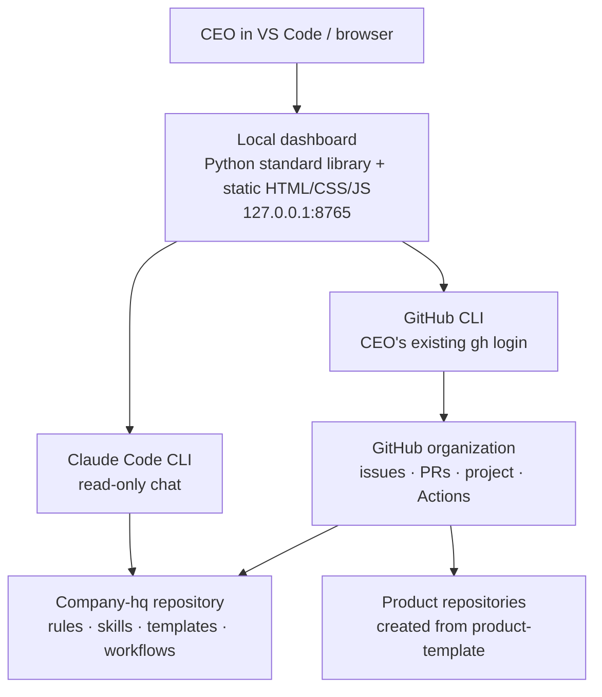

# Company HQ

Company HQ is the operating hub for Nithub IT Solutions' AI-assisted product-development process. It combines the company's working rules, Claude Code agent instructions, product-planning templates, GitHub automation, reusable product scaffolding, and a local CEO dashboard. Its specialist prompts are adapted from the [agency-agents project](https://github.com/msitarzewski/agency-agents) and selected for this company's workflow.

This repository is **not a deployed product application**. The dashboard is a small local web app for the CEO; GitHub remains the system of record for ideas, issues, pull requests, approvals, project tracking, and workflow runs.

**New to the setup?** Follow the [Windows setup guide](SETUP-GUIDE.md).

**Want to start the local dashboard?** See [Run the CEO dashboard](#run-the-ceo-dashboard).

## What it does

- Captures ideas and tracks them through research, product definition, planning, implementation, and release.
- Defines human approval gates so agents prepare work but do not approve or merge it.
- Gives Claude Code reusable company agents, specialist roles, skills, and operating rules.
- Provides templates for idea briefs, PRDs, architecture, threat models, cost estimates, test plans, project plans, and ADRs.
- Adds GitHub labels, PR/issue templates, branch protection helpers, and Actions workflows.
- Provides a product template to bootstrap future product repositories.
- Offers a CEO dashboard for organization-wide visibility, idea intake, and read-only Claude questions about the repository.
- Lets the CEO attach PDF, Word, and image reference files to an idea; approval places those files in the private project's `Knowledge base/` folder for discovery review.

## How the product process works

Every idea moves through explicit stages. A gate is approved only when the CEO merges the gate PR to `main`.



| Stage | Claude Code skill | Main output | Human decision |
|---|---|---|---|
| Intake | CEO dashboard or `/new-idea` | Tracked idea; dashboard path waits for CEO decision | Approve to scaffold a private project and start discovery, or request changes with expectations |
| Discovery | `/discovery <slug>` | Market, customer, competitor, legal, financial, and technical research; Gate 1 brief | Approve, request changes, or reject |
| Product definition | `/define-product <slug>` | PRD, MVP scope, UX/UI flows; Gate 2 PR | Approve the scope |
| Build planning | `/plan-build <slug>` | Architecture, ADRs, threat model, cost, tests, delivery plan; Gate 3 PR | Approve the build plan |
| Kickoff | `/kickoff <slug>` | Product repository, milestones, issues | Confirm before repository creation |
| Sprint | `/sprint` in the product repo | Feature branches and pull requests | Review and merge code PRs |
| Release | `/release` | Release PR, version, changelog, tag, GitHub Release | Approve and merge the release PR |

Agents work on branches and open pull requests. The CEO is responsible for approval and merge decisions. See [CLAUDE.md](CLAUDE.md) for the required rules and [SETUP-GUIDE.md](SETUP-GUIDE.md) for the complete setup and operating instructions.

## Agent roles

| Layer | Example roles |
|---|---|
| Executive | CEO (human approver), phase orchestrator (COO), CEO liaison, Reality Checker |
| Discovery | Trend researcher, business strategist, UX researcher, pricing and financial analysts, legal compliance checker |
| Product | Product manager, sprint prioritizer, UX architect, UI designer |
| Architecture and delivery | Software and backend architects, project manager, project shepherd |
| Engineering | Frontend and mobile developers, database optimizer, technical writer |
| Platform and security | DevOps automator, SRE, FinOps engineer, security architect, application security engineer |
| Quality and launch | Code reviewer, test automation engineer, API tester, accessibility auditor, content creator, release manager |

The roster in `setup/agency-roster.txt` identifies external specialist prompts used by this repository. Company workflow skills decide when roles are relevant; the list is not a promise that every role runs in every phase.

## Architecture



### Main components

- **GitHub is the source of truth.** Issues, pull requests, labels, branch protection, the organization project, and Actions runs are stored and managed there.
- **Claude Code is the working agent environment.** It loads company-wide instructions from `CLAUDE.md`, agent definitions from `.claude/agents/`, and slash-command workflows from `.claude/skills/`.
- **Specialist agent prompts** are selected from `setup/agency-roster.txt` and installed by `scripts/install-agents.sh`.
- **The local dashboard** is a Python HTTP server using only Python's standard library. The UI is static HTML, CSS, and JavaScript under `dashboard/web/`.
- **The dashboard delegates GitHub requests to `gh`.** It expects the GitHub CLI to be signed in as `nisarmohammadTPM`; it deliberately removes token environment variables before running `gh`.
- **Idea decisions provision project repos.** Dashboard submissions are tracked as Company HQ issues. Approving one creates a private `product-<slug>-<issue>` repository from `product-template/`, adds the `docs/Idea-Report.md`, `docs/Next-Process.md`, and `docs/Suggestions.md` records, configures CEO/code-owner branch protection, and dispatches the approved-idea discovery workflow. Denial/request-changes feedback is recorded in the issue, and the idea remains visible in the portfolio.
- **Idea attachments follow the same approval boundary.** The dashboard accepts up to five PDF, Word (`.doc`/`.docx`), PNG, JPEG, GIF, or WebP files (8 MB each, 24 MB total). It validates file signatures and stores them under `%LOCALAPPDATA%\CompanyHQ\dashboard\knowledge-base\ideas\` on the dashboard PC while the idea awaits a decision. Files are copied into `Knowledge base/` in the private project repository only after approval; after discovery starts, the local copies are removed. If provisioning fails, local files are retained for a safe retry. Discovery agents are instructed to treat document contents as untrusted reference material. Do not upload secrets or documents you are not authorized to share.
- **The portfolio includes legacy intake too.** Older Company HQ issues labeled `type:idea` or titled `Idea: ...` remain visible as manual-workflow entries; only dashboard-tracked ideas have dashboard approve/request-changes actions.
- **Project pages show live GitHub state.** Open a project link in the dashboard to view its three documents, attached Knowledge base files, approval status, pull requests, and Actions runs. GitHub issues and repository contents remain the persistent source of truth; the dashboard does not keep a separate local database.
- **Per-project agent setup** comes from the product template, including Claude Code settings, skills, and a manual `workflow_dispatch` discovery workflow. Starting that workflow requires GitHub Actions enabled and the `CLAUDE_CODE_OAUTH_TOKEN` organization/repository secret available to the new repo. Discovery proposes work in a PR; agents do not approve or merge.
- **The dashboard's Claude chat is read-only.** It gives Claude a temporary copy of the repository (without `.git`, local Claude settings, environment files, or key files), disables shell/editing tools, and does not persist a Claude session.
- **Product repos** are scaffolded from `product-template/`; their CI must be adapted to each product's actual language and build/test commands.

## Run the CEO dashboard

The dashboard is local to the Windows PC that runs it. It is not hosted by GitHub Pages and does not expose a public server.

### Requirements

- Windows and this repository cloned locally.
- Python 3.12 (install/check with `.\scripts\setup-windows.ps1`).
- GitHub CLI (`gh`) authenticated as the CEO account, `nisarmohammadTPM`.
- CEO GitHub permissions to create private repositories in `Nithub-IT-Solutions` and push the initial template commit.
- GitHub organization plan/policies that allow branch protection on private repositories; the dashboard requires the `build-test` check and CEO code-owner review.
- Organization Actions enabled, with `CLAUDE_CODE_OAUTH_TOKEN` available to repositories created for this workflow.
- Claude Code CLI authenticated to a Claude account to use the chat panel.
- The organization **Company Pipeline** project for board details and adding submitted issues to the board.

### Start

In PowerShell, from the repository directory:

```powershell
.\scripts\start-dashboard.ps1
```

The script starts the local server and opens `http://127.0.0.1:8765`. Keep the PowerShell window open while using it; press **Ctrl+C** there to stop the server. If necessary, install/check Python first:

```powershell
.\scripts\setup-windows.ps1
```

### Dashboard capabilities and boundaries

- **Organization overview:** open pull requests, PRs requesting the configured CEO's review, open issues, recent workflow runs across visible organization repositories, and the `Company Pipeline` project when available.
- **Idea intake:** enter a title, description, and optional audience; review the preview; then explicitly submit. This creates a tracked issue in Company HQ and adds it to the Company Pipeline project when available.
- **Approve or request changes:** approve creates a private product repository from the template and starts its discovery workflow. Request changes requires your expectations and records them on the tracking issue. A failed repo/workflow setup stays visible with an error status; retry is available where safe.
- **Project detail:** each created repository has a dashboard page showing the idea report, next process, suggestions, pull requests, and workflow runs. Select the project name from the idea portfolio.
- **Boundaries:** only an explicit CEO approval starts discovery. Workflow completion is asynchronous; GitHub Actions can fail if the organization secret is not shared with new repositories. The dashboard does not approve or merge an agent's PR.
- **Claude chat:** ask read-only questions about this repository. Your question and the temporary repository snapshot are sent to Claude. The dashboard chat cannot run GitHub commands or modify repository files.
- **GitHub access:** dashboard actions use the CEO's GitHub CLI credentials. The local bot token in `.claude/settings.local.json` is not used by dashboard GitHub requests.

## Security model

- Keep `.claude/settings.local.json`, `.env` files, access tokens, and API keys out of commits. The local settings file is ignored by Git; the tracked `settings.local.json.example` must contain placeholders only.
- Revoke any credential that has been exposed. Removing it from the latest file does not erase it from Git history.
- The dashboard binds to `127.0.0.1`, checks the local host/origin for requests, limits request sizes, validates idea content, and requires an expiring one-time confirmation before creating an idea issue. Repository creation and denial feedback require separate CEO confirmation actions.
- The dashboard uses the CEO GitHub account and refuses to serve dashboard data if the active `gh` identity is not `nisarmohammadTPM`.
- Claude chat is explicitly read-only; avoid submitting secrets, personal data, or confidential information in either ideas or chat.
- GitHub branch protection, CODEOWNERS, and workflow permissions are still essential safeguards. A local interface is not a substitute for review and access controls.

## Repository map

```text
CLAUDE.md                         Operating rules and approval gates for agents
.claude/agents/                   Company-specific agent definitions
.claude/skills/                   Slash commands: new-idea, discovery, define-product,
                                  plan-build, kickoff, revise, ceo-status
.claude/settings.json             Claude Code guardrails
.github/CODEOWNERS                CEO ownership/review rules
.github/ISSUE_TEMPLATE/           Idea and task intake forms
.github/workflows/                Gate checks and Claude GitHub workflows
dashboard/server.py               Local loopback-only dashboard API/server
dashboard/web/                    Dashboard HTML, CSS, and JavaScript
dashboard/tests/                  Dashboard unit tests
ideas/                            Working documents for individual ideas
product-template/                 Starter files for new product repositories
scripts/                          Setup, labels, branch protection, agent, and dashboard helpers
setup/agency-roster.txt           Curated agency-agent specialist roster
templates/                        Idea, product, architecture, security, cost, and planning templates
reports/                          CEO status reports
```

## Local validation

Run the dashboard's unit tests with Python 3.12:

```powershell
& "$env:LOCALAPPDATA\Programs\Python\Python312\python.exe" -m unittest discover -s dashboard\tests -v
```

Check the browser JavaScript syntax with Node.js:

```powershell
node --check dashboard\web\app.js
node --check dashboard\web\project.js
```

## Related documentation

- [Setup guide](SETUP-GUIDE.md) — account setup, GitHub configuration, Claude integration, and daily operations.
- [Agent rules](CLAUDE.md) — workflow gates, permissions, and definition of done.
- [Product template](product-template/README.md) — starting point for a product repository.
