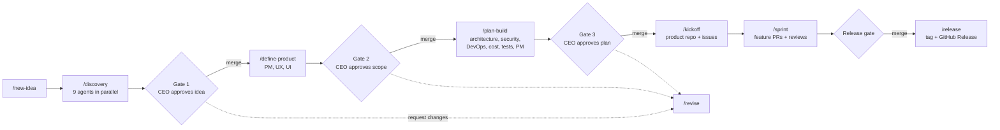

# Nithub IT Solutions — Company HQ

The operating system of an AI-staffed product company. The CEO submits ideas and approves gates;
specialist agents (from [agency-agents](https://github.com/msitarzewski/agency-agents)) running in
Claude Code do the research, planning, building, testing and releasing through GitHub pull requests.

**New here? Start with [SETUP-GUIDE.md](SETUP-GUIDE.md).**

**CEO dashboard (Windows):** after installing Python 3.12 and authenticating GitHub CLI as the CEO, run
`.\scripts\start-dashboard.ps1` from PowerShell in this repository. It opens a local-only dashboard at
`http://127.0.0.1:8765`. The app can submit an idea as a GitHub intake issue after an explicit review
and confirmation, view organization issues/PRs/workflow runs and the Company Pipeline project, and
ask Claude read-only questions about a temporary repository snapshot.

## Pipeline



## Org chart

| Layer | Agents |
|---|---|
| CEO | you (human). Approves every gate and merges every PR |
| Executive | phase-orchestrator (COO), ceo-liaison, Chief of Staff, Reality Checker (independent QA of every gate) |
| Discovery | Trend Researcher, Business Strategist, UX Researcher, Feedback Synthesizer, Pricing Analyst, Financial Analyst, Growth Hacker, SEO Specialist, Legal Compliance Checker |
| Product | Product Manager, Sprint Prioritizer, UX Architect, UI Designer |
| Architecture & PM | Software Architect, Backend Architect, Senior Project Manager, Project Shepherd |
| Engineering | Frontend Developer, Mobile App Builder, Database Optimizer, Git Workflow Master, Technical Writer |
| Platform & Cloud | DevOps Automator, SRE, FinOps Engineer |
| Security | Security Architect, Application Security Engineer |
| Quality | Code Reviewer, Test Automation Engineer, API Tester, Performance Benchmarker, Accessibility Auditor, Evidence Collector |
| Launch | Content Creator, Growth Hacker, release-manager |

## Repository layout

```
CLAUDE.md                 rules every agent follows (gates, git, never-do list)
.claude/agents/           company agents: phase-orchestrator, ceo-liaison, release-manager
.claude/skills/           slash commands: new-idea, discovery, define-product, plan-build, kickoff, revise, ceo-status
.claude/settings.json     guardrails: agents can't push to main, merge, force-push, or delete repos
.github/                  CODEOWNERS (CEO approval), PR + issue templates, workflows (Claude review, @claude, gate-check)
templates/                Idea Brief, PRD, Architecture, ADR, Threat model, Cloud cost, Test strategy, Project plan
ideas/<slug>/             one folder per idea: all research and gate documents
product-template/         scaffold copied into every new product repo (CI, rules, /sprint, /release)
scripts/                  setup-labels, protect-branch, personalize, install-agents, local setup
dashboard/                loopback-only CEO dashboard, static UI, and unit tests
setup/agency-roster.txt   which agency-agents specialists we employ
reports/                  CEO status reports
```
