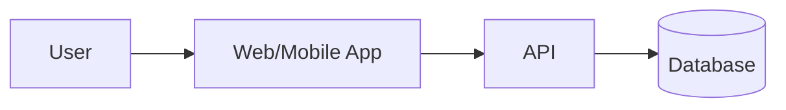

# Architecture: <product>   (Gate 3)

## 1. Context diagram

## 2. Components and responsibilities
## 3. Tech stack (each links to an ADR)
| Layer | Choice | ADR |
|---|---|---|
## 4. Data model
## 5. API design (main endpoints, auth)
## 6. Hosting & environments (dev / staging / prod)
## 7. Scalability & performance plan
## 8. Observability (logs, metrics, alerts)
## 9. Security summary (link 03-threat-model.md)
## 10. Open questions
